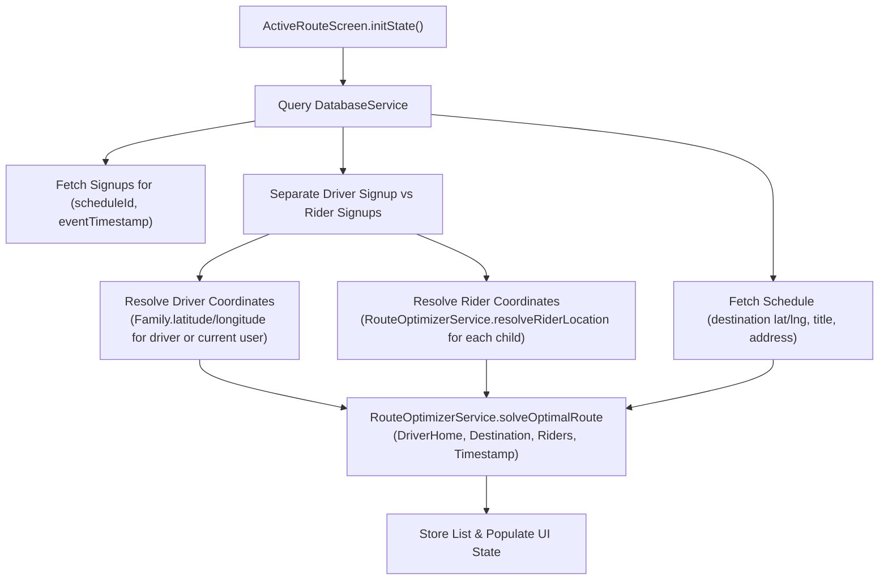

# Design Specification: Dynamic Active Route UI & Interactive Map Wiring

**Date**: 2026-11-14  
**Author**: Antigravity Assistant & Aaron Tolman  
**Status**: Draft (Pending Review & Approval)  
**Target Module**: `lib/screens/active_route_screen.dart` & supporting services  

---

## 1. Intent & The Why

In the current codebase, while `RouteOptimizerService` implements a greedy Traveling Salesperson Problem (TSP) algorithm in isolation and unit tests pass, `ActiveRouteScreen` does not query the local database or calculate dynamic routes. Instead, it renders a static mockup ("Sarah Connor", destination "Clover Park Field 2", and hardcoded PIN "1234") with a placeholder icon for the map.

This design specification details the implementation plan to replace the static mockup with a **dynamic, data-driven active route navigation interface**:
1. Loading real scheduled participants, driver coordinates, and event destinations from `DatabaseService`.
2. Calculating optimal pickup orders and arrival ETAs via `RouteOptimizerService`.
3. Integrating an in-app interactive map using `flutter_map` (OpenStreetMap).
4. Enforcing authentic parent PIN verification for child handoffs.
5. Providing resilient fallback states for empty or unconfigured occurrences.

---

## 2. Goals, Non-Goals & Anti-Goals

### Goals
- **Dynamic Database Integration**: `ActiveRouteScreen` queries the SQLite database for the active `Schedule`, `LocalIcalEvent`, and `Signup`s corresponding to `scheduleId` and `eventTimestamp`.
- **Dynamic TSP Optimization**: Automatically resolves custody schedules per child (US-108) and computes the optimal pickup sequence from Driver Home -> Child Pickups -> Activity Destination.
- **In-App Interactive Map**: Embeds `flutter_map` displaying OpenStreetMap tiles, stop pin markers, and a polyline connecting the waypoints in driving order.
- **Authentic Safety & PIN Handoff**: Renders child booster seat requirements, medical allergy alerts, and validates child pickup PIN against `signup.handoffPin` (when `signup.handoffPinRequired` is true) rather than hardcoded strings.
- **Attendance Logging**: Dispatches Matrix check-in events (`org.carpool.checkin`) with the real child `memberId` and records timestamps in local storage.

### Non-Goals
- Turn-by-turn spoken audio voice navigation (drivers can launch an external navigation app or view the visual sequence).
- Live server-side traffic recalculation (the app remains offline-first and client-side).
- Replacing Matrix communication protocols or database schemas (builds strictly on existing models).

### Anti-Goals
- Hardcoding any passenger, child, destination, or PIN values.
- Requiring proprietary Google or Apple Maps API keys or cloud billing accounts.
- Breaking offline tolerance: if network map tiles cannot be fetched, the itinerary and check-in workflows must continue functioning completely offline.

---

## 3. Constraints
- **Multi-Platform Support**: Must compile and function cleanly on Progressive Web App (Web/WASM), Android, and iOS.
- **Material Design 3**: UI styling, typography, and contrast must adhere to Material 3 standards.
- **Offline Tolerance**: All scheduling, waypoint calculations, and handoff actions must work without an active internet connection.

---

## 4. Evaluated Approaches & Selection

### Approach A: In-App Interactive Slippy Map (`flutter_map` + OpenStreetMap) — **SELECTED**
Embed `flutter_map` (v7) and `latlong2` using OpenStreetMap tiles. Waypoints are plotted as interactive markers, and a route polyline connects the sequence.
- *Pros*: Zero API keys, completely free, runs on Web, Android, and iOS, provides an authentic in-app visual map.
- *Trade-off*: Adds `flutter_map` and `latlong2` to `pubspec.yaml`; requires graceful offline tile fallback.

### Approach B: High-Contrast Custom Vector Canvas + External Maps Handoff
Render a custom vector graphic canvas representing sequential stops, paired with an "Open Turn-by-Turn in Navigation" button.
- *Trade-off*: Lacks in-app pan/zoom tile exploration; relies on external map switching.

**Decision**: The human partner confirmed **Approach A**.

---

## 5. Detailed Architecture & Implementation Specification

### 5.1 Data Resolution Flow
When `ActiveRouteScreen` initializes with `scheduleId` and `eventTimestamp`:



1. **Driver Location Resolution**:
   - Query driver signup where `role == 'driver'` and `status != 'canceled'`.
   - Retrieve the driver's `Family` coordinates. If not found, fall back to current signed-in user's `Family` coordinates in `DatabaseService`. If coordinates are unset (0.0, 0.0), default to schedule destination offset or prompt user.
2. **Passenger Locations & Profiles**:
   - Query all signups where `role == 'rider'` and `status != 'canceled'`.
   - For each signup, fetch the corresponding `FamilyMember` and their associated `Family`.
   - Call `RouteOptimizerService.resolveRiderLocation(member: member, family: family, eventTimestamp: eventTimestamp)` to factor in alternating co-parenting custody schedules (US-108).
3. **Destination Resolution**:
   - Destination coordinates and address taken directly from `Schedule.latitude`, `Schedule.longitude`, and `Schedule.addressText`.

### 5.2 Dynamic Route Calculation
- Pass resolved `LocationCoord driverHome`, `LocationCoord destination`, and `List<LocationCoord> riders` to `RouteOptimizerService.solveOptimalRoute(...)`.
- The returned `List<RouteWaypoint>` defines the ordered sequence of stops:
  - Stop 0: Driver start (`driver_start`)
  - Stop 1..N: Child pickups in optimal greedy TSP order (`pickup`)
  - Stop N+1: Activity destination (`destination`)

### 5.3 Map Implementation (`flutter_map`)
- In `pubspec.yaml`, add:
  ```yaml
  dependencies:
    flutter_map: ^7.0.2
    latlong2: ^0.9.1
  ```
- Map Container rendered at top of screen (height: 220–250px):
  - `MapOptions`:
    - Initial camera centered on bounding box covering all waypoints.
    - Pinch-to-zoom enabled, min zoom: 3, max zoom: 18.
  - `TileLayer`:
    - URL: `https://tile.openstreetmap.org/{z}/{x}/{y}.png`
    - `userAgentPackageName`: `'org.carpool.coordinator'`
    - Graceful fallback: If tiles cannot load (offline), the map background displays the theme's surface color with a subtle offline indicator rather than an error banner.
  - `PolylineLayer`:
    - Polyline connecting waypoint coordinates in sequential TSP order with a high-contrast accent color (e.g. `Color(0xFF1D4ED8)`), stroke width 4.0.
  - `MarkerLayer`:
    - **Driver Start**: Blue car pin icon with tooltip "Start: Driver".
    - **Pickups**: Indigo circular badges with pickup index number (1, 2, ...), displaying child initials and tooltip with child name.
    - **Destination**: Green checkered flag / destination pin with event title.

### 5.4 Stop Itinerary & Interactive Actions List
Each stop in the optimized itinerary is rendered as an interactive card:
- **Header**: Stop number, estimated arrival time (formatted as HH:mm a), and address text.
- **Child Pickups**:
  - Child's full name from `FamilyMember.name`.
  - Safety Chips:
    - If `FamilyMember.requiresBoosterSeat == true`: Display "Booster Seat Required" chip with seat icon.
    - If `FamilyMember.medicalNotes.isNotEmpty`: Display red "Medical Note" chip with emergency medical dialog on tap.
  - **Handoff Verification (US-111 & US-212)**:
    - If `signup.handoffPinRequired == true`:
      - Tap "Child Boarded" -> Dialog prompts for parent PIN.
      - Validate against `signup.handoffPin`. Allow driver override/bypass if parent is present in person.
    - If `signup.handoffPinRequired == false`:
      - Tap "Child Boarded" records instant check-in.
    - "Child Delivered" drop-off confirmation button.
    - State tracking: Updates local UI button state (`_checkedInMembers`) and dispatches `matrixService.sendAttendanceCheckin(scheduleId, eventTimestamp, memberId, action, driverId)`.
  - **Emergency Actions**:
    - Emergency medical contact modal showing `FamilyMember.emergencyContact` and `FamilyMember.medicalNotes`.
    - Emergency route segment transfer (US-213) to another circle driver.

### 5.5 Edge Cases & Empty States
1. **No Riders Registered**:
   - If `riders.isEmpty`, display a clean `EmptyStateWidget` stating "No riders registered for this carpool occurrence yet", with a button to return to the Schedule screen.
2. **Missing Home Coordinates**:
   - If driver or family coordinates are (0.0, 0.0), present a clear warning banner with a shortcut to update the address in Settings.
3. **Single Rider**:
   - Directly creates a 3-stop route: Driver -> Rider -> Destination.

---

## 6. What's Left to the Builder
- Precise layout padding and color styling using Material 3 theme properties.
- Exact map bounds padding calculation (`CameraFit.bounds` with padding).
- Unit and widget test updates in `test/user_stories_test.dart` to assert dynamic waypoint rendering against test databases.
